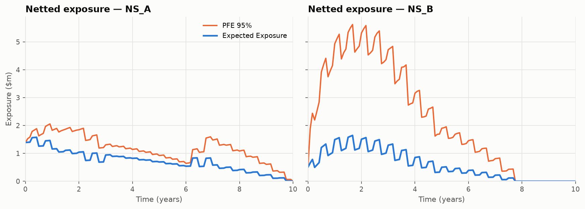
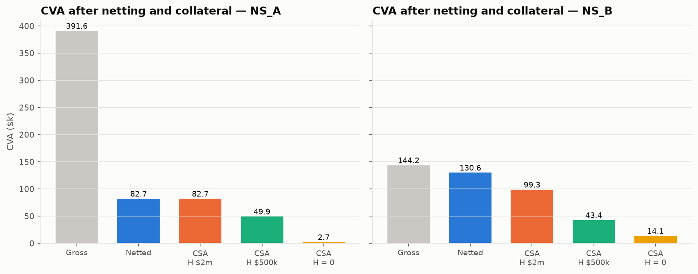
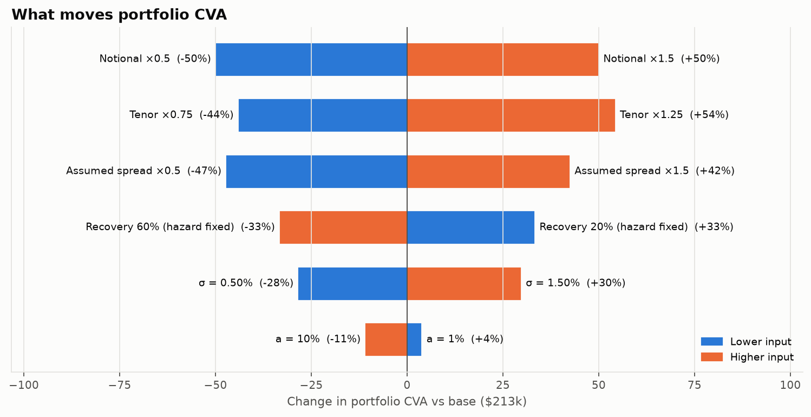

# Counterparty Credit Risk & CVA Engine

[](https://github.com/jinsyparker/counterparty-credit-risk-cva-engine/actions/workflows/tests.yml)

[](LICENSE)

A Monte Carlo counterparty-credit-risk engine for a portfolio of vanilla USD interest-rate swaps. It prices the swaps on a zero
curve bootstrapped from the US Treasury par-yield curve, simulates future rates with an exact one-factor Hull-White model, turns
future portfolio values into netted exposure profiles (EE, PFE), prices unilateral CVA from default probabilities and recovery,
and measures how netting, collateral, and credit and market assumptions change it.

**Research question:** how do market movements, portfolio netting, collateral assumptions and counterparty credit quality affect
the expected exposure and CVA of a derivatives portfolio?

## Highlights

- **Exact rate simulation.** The Hull-White factor and its time integral are drawn from their exact joint Gaussian transition, so
  there is no discretisation bias; simulated bond prices pass the martingale test E[D(0,t)·P(t,T)] = P(0,T).
- **Risk-neutral CVA with error bars.** CVA discounts each path with its own simulated bank account and reports a Monte Carlo
  standard error; the textbook deterministic-discount formula is kept as a benchmark.
- **Collateral on the same scenarios.** Margin-period look-back dates are added to the existing paths by an exact Gaussian bridge,
  so collateralized and uncollateralized CVA are compared on identical simulated markets.
- **Validated, not just computed.** 145 tests cover exact identities (par swap = 0, closed forms), statistical checks (moments,
  martingales, 1/√N convergence) and economic monotonicities (netting, collateral, hazard, recovery), run in CI on Python 3.11 and 3.12.
- **Reproducible.** One command regenerates every figure, table and the results below; a second rebuilds the PDF report.

## Start here

1. [**The report (PDF)**](reports/CVA_Engine_Report.pdf): the whole project in 17 illustrated pages, from the curve to collateralized CVA.
2. [**Technical note**](docs/technical_note.md): every formula and model choice, with the validation strategy and model-risk table.
3. [**Notebooks**](notebooks/): `01`–`05` walk through each stage with outputs.
4. [**Source**](src/): the engine; [`run_all.py`](run_all.py) is the end-to-end pipeline.

## Results

<!-- results:start -->
*Generated by `run_all.py` (valuation date 2026-10-02, 10,000 paths, seed 42). Numbers come from `reports/tables`.*

| Netting set | EPE (time-avg EE) | Peak PFE 95% | CVA netted (± 1 s.e.) | CVA gross | Netting | Zero-threshold CSA |
|---|---|---|---|---|---|---|
| NS_A | $0.72m | $2.06m | $82.7k ± $0.2k | $391.6k | −79% | $2.7k |
| NS_B | $0.72m | $5.62m | $130.6k ± $1.3k | $144.2k | −9% | $14.1k |
| **Portfolio** | | | **$213.3k ± $1.5k** | $535.8k | −60% | $16.7k |

**Project summary**

- Built a Monte Carlo counterparty-credit-risk engine in Python for a 10-swap USD interest-rate portfolio: bootstrapped a US Treasury zero curve, simulated an exact one-factor Hull-White model (10,000 paths × 121 dates, martingale-tested) and priced unilateral CVA with pathwise discounting to ±0.7% Monte Carlo precision.
- Quantified counterparty-risk mitigation: legal netting cut portfolio CVA by 60% (79% for a balanced netting set vs 9% for a one-directional one), a zero-threshold CSA with a 14-day margin period removed a further 92%, and common-random-number sensitivities ranked the CVA drivers (portfolio tenor, credit spread, recovery, rate volatility).
<!-- results:end -->

Full scenario tables are in [`reports/final_project_summary.md`](reports/final_project_summary.md).







## How it works

| Step | Method | Code |
|---|---|---|
| Curve | Bootstrap semiannual Treasury par yields; interpolate linearly in log discount factor | `src/curves.py` |
| Pricing | Single-curve fixed and floating legs on arrays of discount factors (the same code prices today and on every simulated path) | `src/swap_pricer.py` |
| Rates | Hull-White 1F written as r = x + φ(t); x and ∫x simulated **exactly** (no discretization bias); closed-form P(t,T); fits today's curve by construction | `src/rate_models.py`, `src/simulation.py` |
| Revaluation | Every swap on every path and date (monthly plus all cash-flow dates), with pathwise floating fixings | `src/simulation.py` |
| Exposure | Net within each netting set **before** taking max(V, 0); EE, empirical PFE, EPE (time-average EE) | `src/exposure.py` |
| Credit | Hazard rate from assumed CDS-equivalent spreads (λ ≈ s/(1−R)); survival and marginal default probabilities | `src/credit.py` |
| CVA | LGD × Σ E[D(0,t)·E(t)] × ΔPD with pathwise stochastic discounting on the full grid, plus Monte Carlo standard errors | `src/cva.py` |
| Collateral | One-way CSA with threshold, MTA and margin period of risk; look-back dates added to the same paths by an exact Gaussian bridge | `src/collateral.py` |
| Validation | Convergence, common-random-number sensitivities, and a pytest suite of exact and statistical checks | `src/validation.py`, `tests/` |

The formulas, derivations and design choices are in [`docs/technical_note.md`](docs/technical_note.md).

## Assumptions

| Input | Base case | Source |
|---|---|---|
| Valuation date and curve | 2 Oct 2026 US Treasury par yields (1M–30Y) | `data/curves/`, public Treasury data |
| Portfolio | 10 synthetic USD swaps in 2 netting sets (NS_A balanced payers/receivers, NS_B mostly payers), $265m notional | `data/reference_inputs/portfolio.csv` |
| Rate model | Hull-White a = 3%/yr, σ = 1%/√yr (short-rate diffusion vol, not a swaption vol); assumed, not calibrated | `src/config.py` |
| Simulation | 10,000 paths, seed 42, 121 dates (monthly plus cash-flow dates) | `src/config.py` |
| Credit | Assumed spreads 150bp (CPTY_A) and 300bp (CPTY_B), recovery 40%, flat hazards | `data/reference_inputs/counterparties.csv` |
| Collateral | One-way CSA scenarios: threshold $2m/MTA $250k, $500k/$100k, zero; MPoR 2 weeks | `src/config.py` |
| Risk measures | PFE at 95%; CVA headline with pathwise discounting; deterministic-discount benchmark reported | `src/config.py` |

## Validation

Every check in the project specification is covered by an automated test, along with model-level checks:

| Check | Where |
|---|---|
| Par swap ≈ 0; payer = −receiver; bootstrap reprices every Treasury bond | `tests/test_pricing.py`, `tests/test_curves.py` |
| Hull-White moments, mean reversion, martingale E[D(0,t)P(t,T)] = P(0,T) | `tests/test_rate_models.py` |
| σ = 0 reproduces forward values (fixings correct); cube(t = 0) = pricer | `tests/test_simulation.py` |
| Exposure ≥ 0; netted ≤ gross on every path; PFE reconciles with the simulated distribution | `tests/test_exposure.py` |
| Survival falls; marginal PDs sum to cumulative PD | `tests/test_credit.py` |
| CVA rises with hazard and notional, falls with recovery; zero-default and full-recovery give 0; continuous closed form | `tests/test_cva.py` |
| Tighter collateral lowers exposure and CVA; infinite threshold equals uncollateralized; bridge is exact | `tests/test_collateral.py`, `tests/test_simulation.py` |
| Standard error ∝ 1/√N; sensitivities move in the right direction | `tests/test_cva.py`, `tests/test_validation.py` |

## Quick start

```bash
git clone https://github.com/jinsyparker/counterparty-credit-risk-cva-engine.git
cd counterparty-credit-risk-cva-engine
python3 -m venv .venv && source .venv/bin/activate     # Python 3.11 or 3.12
pip install -r requirements.txt

python -m pytest -q                  # full test suite
python run_all.py                    # regenerates reports/ and the results above (about 30 s); --quick uses 2,000 paths
python scripts/build_report.py --pdf # rebuilds reports/CVA_Engine_Report.pdf (needs Google Chrome or Chromium)
```

Notebooks (run headless with `jupyter nbconvert --execute`) walk through each stage: `01_swap_pricing`, `02_rate_simulation`, `03_exposure_profiles`, `04_cva_and_sensitivities`, `05_collateral`.

## Repository layout

```text
data/curves/            Treasury par-yield snapshot (2026-10-02)
data/reference_inputs/  synthetic portfolio and counterparty credit assumptions
src/                    curves, instruments, swap_pricer, rate_models, simulation, exposure,
                        credit, cva, collateral, validation, reporting, plotting, config
scripts/                curve download, portfolio generation, report builder
notebooks/              01–05, one per stage
tests/                  pytest suite
reports/                figures, tables (generated), final_project_summary.md, CVA_Engine_Report.pdf
docs/                   technical_note.md, PLAN.md (build roadmap and review log)
.github/workflows/      CI: end-to-end run and test suite on Python 3.11 and 3.12
run_all.py              single reproducible runner
```

## Limitations and model risk

- **Single curve.** Treasury rates both discount and project; there is no SOFR/OIS multi-curve basis.
- **One-factor Gaussian rates.** All rates move together, so curve-hedged books look less risky than they are, and rates can go negative.
- **Uncalibrated rate parameters.** a and σ are assumptions; CVA for directional books scales roughly linearly with σ.
- **Approximate credit.** Hazards come from assumed spreads via the credit triangle, not a CDS-curve calibration. They are deterministic and independent of rates, so there is no wrong-way risk and CVA is only unilateral.
- **Simplified collateral.** MTA is added to the threshold, coupons are paid during the margin period, and there is no initial margin or haircut.
- **Simplified schedules.** There are no day counts, calendars or historical fixings.

These are deliberate scope limits for an explainable engine; the technical note lists the expected direction of each effect.

## Development process

This project was built with the help of an AI coding assistant (Claude Code). The modelling choices, validation criteria and
the changes made after review are documented in [`docs/technical_note.md`](docs/technical_note.md) and
[`docs/PLAN.md`](docs/PLAN.md).

## Author

**jinsyparker** · [github.com/jinsyparker](https://github.com/jinsyparker)

## License

Released under the [MIT License](LICENSE). The US Treasury yield data is public; the swap portfolio and counterparty inputs are synthetic.
